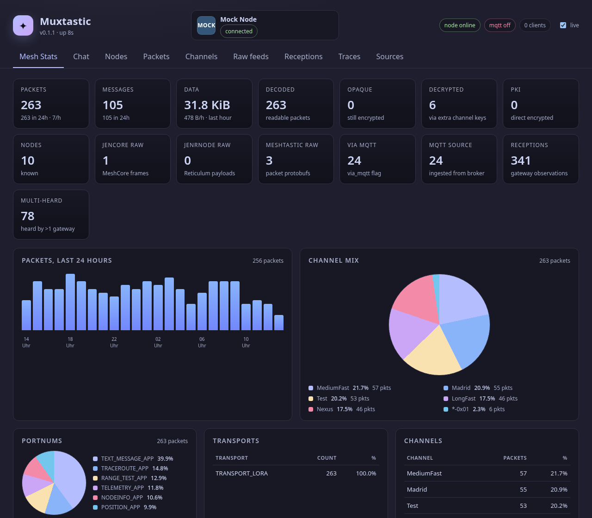
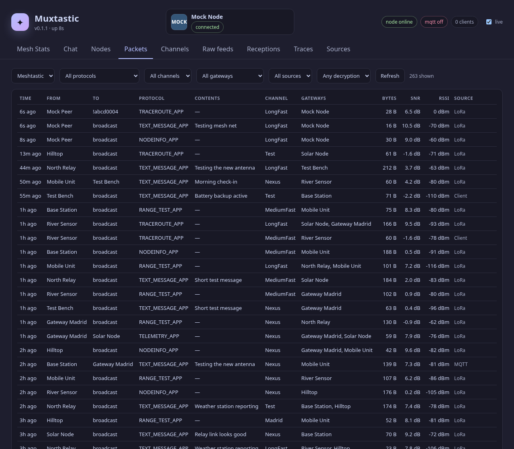

<div align="center">

# Muxtastic

**One radio. Many apps.**

A small Rust multiplexer for [Meshtastic®](https://meshtastic.org/): share one
node between apps, run several nodes at once, bridge MQTT, and keep a searchable
SQLite history.

[](https://www.rust-lang.org/)
[](LICENSE)
[](https://meshtastic.org/)
[](Dockerfile)

[Quick start](#quick-start) · [Screenshots](#screenshots) · [Config](#configuration) · [Docs](#documentation)

</div>

```text
App 1 ─┐
App 2 ─┼── TCP :4404 ──► Muxtastic ── serial/TCP :4403 ──► physical node
App N ─┘                  Rust/Tokio
                             └── SQLite + web UI + optional MQTT bridge
```

## Screenshots

<p align="center">
  
  
</p>
<p align="center"><em>Synthetic mock data.</em></p>

## Features

- Multi-client PhoneAPI multiplexing with full config replay
- Serial, TCP, mock links; multiple `[[nodes]]` in one process
- MQTT proxy relay, raw gateway, standard mirror, optional second broker
- SQLite history and dashboard: Stats, Chat, Nodes, Packets, Channels, Raw,
  Receptions, Traces, Sources
- Packet and node family switches for Meshtastic, MeshCore and Reticulum
- MeshCore/Reticulum advert tracking and repeated-reception counts in Chat
- Per-gateway receptions, channel scoping, gateway-name resolution
- Per-source RSSI/SNR/Δf graphs and relay-node signal statistics
- Sources dropdowns for direct nodes, MQTT gateways and connected clients
  (peer, connected/idle time, RX/TX)
- Extra channel decryption (base64 PSKs, one-byte keys, `*` wildcards)
- Admin security, config-dump filtering, mDNS, Docker, multi-arch releases

## Quick start

Requires Rust 1.88+ and a Meshtastic node over USB serial or TCP.

```bash
cargo build --release --locked -p muxtastic
cp configs/muxtastic.example.toml muxtastic.toml
./target/release/muxtastic --config muxtastic.toml
```

No hardware:

```bash
cargo run -p muxtastic -- --mock
```

Dashboard: <http://127.0.0.1:8080> · mux port: `4404`.

Docker:

```bash
cp configs/config.example.yaml configs/config.yaml
docker compose up -d
```

| Option | Description |
|---|---|
| `-c, --config PATH` | TOML (native) or YAML (legacy) config |
| `--mock` | Simulated physical node |
| `--web-only` | Dashboard only, fed by `[web.mqtt]` |

## Configuration

TOML and legacy YAML use the same typed model. `server.port` cannot be `4403`.
Start from [`configs/muxtastic.example.toml`](configs/muxtastic.example.toml) or
[`configs/config.example.yaml`](configs/config.example.yaml).

```toml
[security]
blocked_portnums = ["ADMIN_APP"]
allow_admin_from = ["100.64.0.0/10"]

[node]
type = "tcp"
tcp_host = "192.168.1.37"
tcp_port = 4403

[server]
host = "0.0.0.0"
port = 4404

[web]
enabled = true
host = "127.0.0.1"
port = 8080
database = "data/muxtastic.db"
storage = "sqlite"          # "sqlite" or "memory" (volatile)
retention_days = 7
```

Multiple radios: use `[[nodes]]` with unique names and client ports. See
[`configs/multi-node.example.toml`](configs/multi-node.example.toml).

Extra channel decryption:

```toml
[[web.extra_channels]]
name = "Madrid"
key = "AQ=="

[[web.extra_channels]]
name = "*"
key = "AQ=="

[web]
try_all_one_byte_keys = true
```

## Web UI

Loopback-only by default, no authentication; use a reverse proxy if exposed.
The read-only `[web.mqtt]` source can run with `--web-only` or alongside
physical nodes. See [docs/web-ui.md](docs/web-ui.md).

## MQTT bridge

```toml
[mqtt_bridge]
enabled = true
broker = "mqtt.meshtastic.org"
port = 8883
tls = true
username = ""
password = ""
root_topic = "msh"
raw_root_topic = "raw"
downlink_enabled = false
```

Proxy relay, raw gateway, standard mirror, downlink injection, JRAW feeds, and
once-per-boot provisioning. Full reference: [docs/mqtt.md](docs/mqtt.md).

## Security

| Direction | Rule |
|---|---|
| Client → node | `ADMIN_APP` needs loopback, `allow_admin_from`, or `from == to` |
| `removeByNodenum` | Fake success ACK; command dropped |
| `addContact` | Always blocked |
| `from == 0` + PKI | Encryption stripped before forwarding |
| Node → client | Config dumps suppressed; replay instead |

Framing: `0x94 0xC3` + 2-byte length, max 512 bytes; `ToRadio`/`FromRadio`
protobufs.

## Documentation

- [MQTT bridge](docs/mqtt.md)
- [Web UI, API and database](docs/web-ui.md)
- [Example configs](configs/)
- [Dockerfile](Dockerfile) · [compose file](docker-compose.yml)

## Development

```bash
cargo test --workspace
cargo clippy --workspace --all-targets -- -D warnings
cargo fmt --all --check
```

## Releases

Manual **Actions → Release → Run workflow**, tag input. Builds Linux x86_64,
ARM64 and ARMv7 archives with checksums via [`.github/workflows/release.yml`](.github/workflows/release.yml).

## License

AGPL-3.0-or-later. The GPL-3.0 `meshtastic` crate supplies the protobuf types.

## Trademarks

Meshtastic® is a registered trademark of Meshtastic LLC. Muxtastic is an
independent project and is not affiliated with, endorsed by, or sponsored by
Meshtastic LLC.

Inspired by [MeshMonitor](https://github.com/Yeraze/meshmonitor) and
[Multiplextashtic](https://github.com/gargomoma/multiplextashtic).
